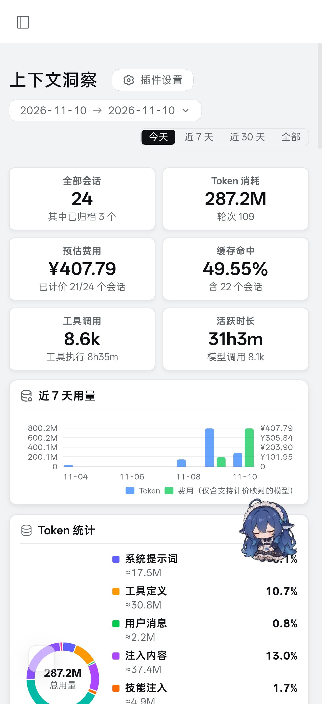

# dsh-price-mixer

[](https://github.com/deepseek-ai/deepseek-harness)

给 [DeepSeek Harness](https://github.com/deepseek-ai/deepseek-harness)（DSH）的 [dsh-context](https://github.com/bowenliang123/dsh-context) 成本估算**补上自定义模型的价格**，并提供一个侧栏面板让你核对匹配、固定别名、手填单价。

A DSH plugin that discovers the models your profile actually configures, matches each name against the models.dev price book (family / version / tier slots with confidence levels), and injects those prices into the book `dsh-context` fetches — so proxied models finally show an **Est. Cost** in the Context panel instead of `—`.

---

## 它解决什么问题

dsh-context 的 Est. Cost = token 数 × 单价，单价来自 [models.dev](https://models.dev) 的公开价格簿。跑自建网关的人会撞上三堵墙：

1. **provider 不在簿子上就永远无价。** 你自建的 provider（例如 `agent2api`）在 models.dev 的 235 个 provider 里查不到 → dsh-context 直接判定 `Not priced`。
2. **同名模型无法唯一归属。** 同一个名字（`glm-5.3`、`kimi-k3`）挂着几十家厂商、报价各不相同，dsh-context 只能标 ambiguous。
3. **网关的模型名和官方名对不上。** 这是最要命的一条：`kimi-k3-1`（其实是 k3.1）、`DeepSeek-V4-Pro-Official-max`、`qwen3.8-max-max`、`agy-cli/gemini-4-argon`……前后缀怎么变没人保证，纯字符串比对必然漏，强行模糊匹配又会把 `qwen3.8-max` 配到 `qwen3-8b` 上去。

结果是：你明明在烧 token，面板却告诉你**成本 `—`**（或者更糟，一个悄悄算错的价格）。

这个插件在**不改 dsh-context 任何文件、不起任何服务、不占任何端口、不碰任何密钥**的前提下把价格缝进去，并且对每一个价格都说清"它凭什么这么配"。

## 它怎么做的

宿主启动时给 `globalThis.fetch` 套一层壳，**只认一个 URL**：`https://models.dev/api.json`。

```
cordis.patch.yml ──读配置──▶ [模型清单]        ← 不用网关 /v1/models，不用 API key
                                   │
dsh-context ──fetch(api.json)──▶ [壳] ──fetch──▶ models.dev   拉真价格簿
                                   │
                                   ├─ 按配置里的 provider 名注入价格段
                                   ▼
                          dsh-context 收到「权威价格簿 + 我方私货」
```

- **模型清单来自配置**：只读 `providers.<name>.models[].id`（含 `- id: x` 行内写法），支持 `agy-cli/gemini-4-argon` 这种带命名空间前缀的 id。你往配置里加模型，面板会自动多一行，不需要改插件、不需要重启插件。
- 其它任何请求原样放行；注入路径任何一步抛错都**回退成重拉原书透传** → 最坏结果是"没有自定义价"，绝不会弄坏价格簿。
- 权威源照常走，上游调价自动跟随（自动匹配部分不写死数值）。
- dsh-context 缓存价格簿的 1 小时 TTL 不受影响。

## 匹配机制：拆槽打分，不猜

每个模型名（你的和价格簿里的）都被拆成四槽，**位置无关**，所以前缀后缀怎么加都能认：

| 槽 | 例（`DeepSeek-V4-Pro-Official-max`） | 处理 |
|---|---|---|
| family | `deepseek` | 硬过滤：家族不同直接不比 |
| version | `4` | `v`/`k`/`k3-1`=`k3.1` 这类分隔符归一；`qwen3-8b` 里的 `8b` 是参数量不是版本 |
| tier | `pro` | `flash`/`pro`/`preview`/`flashx`…；`max` 视为网关后缀（归一成 base） |
| 其它 | `official`、`max` | 双方共有的加分，只有你要而对方没有的扣分（网关噪声不扣） |

打分：家族 40（必需）+ 版本一致 42 / 子版本待定 8 + 档位一致 34 / 两边都无档 24 + 同名 25 + 官方厂商 8 + 共有词 6/个 − 缺失词 6/个（上限 18）。**至少要有一个真锚点**（同名、版本相等或前缀关系、或共有词），否则直接判不匹配 —— 这条拦住了 `hy4free → hy3` 这种同家族瞎配。

family 怎么认：**从左往右扫，取第一个在价格簿里真实存在的家族**。所以 `gateway-deepseek-v4-flash-tencent` 认 deepseek（不是 gateway）、`ms-kimi-k3` 认 kimi（不是 ms）、`ali-minimax/minimax-m3` 认 minimax。网关前缀和 `-tencent`/`-kuaishou` 这类转卖后缀都算噪声，不扣分。

结果分六档（前四档注入价格，后两档是**兜底**）：

| 标签 | 条件 | 行为 |
|---|---|---|
| **精确** | 得分 ≥ 88 且领先第二名 ≥ 12，且有官方厂商报价或全库同价 | 直接注入 |
| **档位** | 版本对得上，但该版本在簿子上只有一档（`kimi-k3-1` → 只有 `k3.1-pro`） | 注入，并注明按哪一档计 |
| **估价** | 名称对得上但没有官方厂商，网关报价又各不相同 | 注入**出现次数最多的那个价**，标注估价 |
| **版本估** | 家族 + 版本都对，但没有任何一方列出你这个档位 | 按该版本**报价最多的那一档**估（L2） |
| **家族估** | 版本在簿子上也没有 | 按**最接近的版本**粗估（L3，要求名字里带版本号，否则不乱估） |
| **待定** | 得分 60–87，或前两名咬得太近，或价格远超同家族同档区间 | **不注入**，面板列出 top 3 候选等你点 |

兜底顺序就是「先家族 → 再版本 → 再 flash 这种档位」：能对上族就进族（40 分起），能对上版本就按版本（L2），只剩族就按最接近的版本粗估（L3）。**每一档都会在面板里标出来，绝不混进"精确"。**

优先级（最高在前）：**手填价 → 固定别名 → 自动匹配**。手填和别名存在 `~/.dsh/price-mixer.json`，永远覆盖自动结果。

另两条防呆：

- **plan provider 一律跳过**：`zhipuai-coding-plan`、`xiaomi-token-plan-ams`、`volcengine-coding-plan` 这类订阅制条目在簿子上报价是 `0/0`，拿它当价会把成本算成 0。
- **同家族同档价格区间**：自动价若超出该家族该档中位数的 4 倍（或低于 1/4），降级成待定，不硬塞。

## 侧栏面板

侧栏「价格影子」图标 → 打开后列出**配置里真实存在的每个模型**：

- 每行：模型 id + 置信标签（**精确 / 档位 / 估价 / 版本估 / 家族估 / 待定 / 别名 / 手填 / 无价**）+ 用途 provider + 匹配到的簿上条目 + 一句"凭什么"（含得分）
- 四个输入框：输入 / 输出 / 缓存读 / 缓存写（USD per 1M tokens）
- 按钮：**手填保存**、**撤销手填**、**解除固定**、**候选 N**（展开 top 3，每行一个"采用"）、**标记免费/无价**
- 顶栏：**刷新** / **重扫配置** / **重读价格簿** / **清空手填**，以及筛选（全部 / 待处理 / 估价 / 已固定 / 精确）
- 顶部还会写明**这次读的是哪个配置文件**（`web/cordis.patch.yml（1 供应商 / 36 模型）`），读错文件一眼能看出来

价格簿由插件自己按需拉取（后台进行、1 小时缓存、60s 超时、失败保留上次结果），**不依赖 dsh-context 先取过一次**；面板打开时会自动轮询到就绪。



## 依赖

| 依赖 | 版本要求 | 说明 |
|---|---|---|
| **DeepSeek Harness** | `>= 0.2.0-rc.2`（实测 0.2.2-rc.1） | 插件宿主；用到 `webServer` 服务与 `slots` 客户端插槽 |
| **Node.js** | `>= 22.19.0`（实测 24.9.0） | 宿主运行时；用到全局 `fetch` / `Response` / `AbortSignal.timeout` |
| **dsh-context** | 任意版本（实测 0.83.1） | **被增强方**，不是硬依赖：没装它插件也能跑，只是没有 Est. Cost 可看 |
| **@deepseek-ai/dsh-client-ui-slots** | 随 DSH 提供 | 客户端插槽（`sidebar.panellist` / `main`） |
| 网络 | 需要能访问 `https://models.dev/api.json` | 约 6 MB；拉不到时插件退化为"只用上次结果 + 手填" |

**不依赖**：任何外部服务、端口、数据库、Python、Docker、API key。插件没有 npm 运行时依赖（只有 `node:fs` / `node:os` / `node:path`）。

## 安装

DSH 的 profile 目录（默认 `~/.dsh/profiles/web`）下有两种装法。

### 方式 A：从 npm 安装（推荐）

```bash
dsh plugin --profile web add dsh-price-mixer
```

已发布到 npm：[dsh-price-mixer](https://www.npmjs.com/package/dsh-price-mixer)（仓库地址、版本历史、README 在那边都能看到）。

### 方式 B：从 GitHub 安装（想跟最新提交时）

```bash
dsh plugin --profile web add github:ymf2317-tech/dsh-price-mixer
```

### 方式 C：本地 vendor 目录（不想让它自动更新时）

```bash
# 1. 放到 profile 的 vendor 下
cd ~/.dsh/profiles/web
git clone https://github.com/ymf2317-tech/dsh-price-mixer vendor/dsh-price-mixer

# 2. 在 package.json 的 dependencies 里加一行
#    "dsh-price-mixer": "file:vendor/dsh-price-mixer"
#    并在 dsh.profile.bundles 数组里加 "dsh-price-mixer"
pnpm install
```

> ⚠️ 必须是 `file:vendor/...` 形式并登记到 `dsh.profile.bundles`，否则下次 `dsh plugin install` 会把 vendor 里的东西 prune 掉。
> ⚠️ `file:` 依赖在 `node_modules` 里是**复制**不是软链：改了 vendor 侧文件后要 `rm -rf node_modules/dsh-price-mixer && pnpm install` 才会刷新。

安装后**重启 dsh**，浏览器再 `Ctrl+Shift+R`。验证：

```bash
curl -s http://127.0.0.1:<web端口>/price-mixer/status
# 期望：{"ok":true,"installed":true,"discovery":{...},"lastInjection":{...}}
```

## 配置

手填价与别名存在 `~/.dsh/price-mixer.json`（首次保存时自动创建，放在 `~/.dsh` 下，**插件升级/重装都不会冲掉**）：

```json
{
  "overrides": {
    "glm-5.3-max": { "input": 1.2, "output": 4.2, "cache_read": 0.3, "cache_write": 1.2 }
  },
  "aliases": {
    "kimi-k3-1": "moonshotai/kimi-k3.1-pro",
    "hy4free": null
  }
}
```

- `overrides`：手填价，单位 USD / 1M tokens；`cache_read` / `cache_write` 省略时默认等于 `input`。删掉某个键 = 回落到自动匹配。
- `aliases`：把某个模型 id **钉死**到价格簿里的 `provider/model`（面板点「采用」即写入）；值为 `null` = 明确"这个模型无价/免费"，不再猜。
- 两个键都可以手写。删掉整个文件 = 全部回到自动匹配。

**生效时机**：dsh-context 自己缓存价格簿 1 小时，所以保存后要等它下一次取价，或重启宿主。这是上游缓存策略，本插件不去打补丁绕它。

## HTTP API

插件在 host 侧挂了一组路由（同一个 webServer，无需额外端口）：

| 方法 | 路径 | 用途 |
|---|---|---|
| GET | `/price-mixer/status` | 壳状态、注入计数、**配置发现结果**、别名列表、最近日志 |
| GET | `/price-mixer/models` | 每个模型 + 置信标签 + 生效价 + 候选（不阻塞；价格簿未就绪时 `book.loading=true`） |
| POST | `/price-mixer/reload` | 强制重读权威价格簿（后台拉，立即返回） |
| POST | `/price-mixer/rescan` | 重新扫描配置文件（加模型后不用重启即可看到） |
| POST | `/price-mixer/override` | `{ model, input, output, cache_read?, cache_write? }` 写手填价 |
| POST | `/price-mixer/reset` | `{ model }` 或 `{ all: true }` |
| POST | `/price-mixer/alias` | `{ model, canonical }` 固定别名，`{ model, canonical: null }` 解除 |

## 离线自测

```bash
# 先另存一份价格簿（约 6MB）
curl -sL https://models.dev/api.json -o /tmp/md.json
npm test                                 # 读本机配置 + /tmp/md.json，打印每个模型的匹配结果
# 或指定文件
node test/match-check.mjs /tmp/md.json --verbose
```

脚本会校验四件事：每个已定价模型都能落到一个簿上条目、注入条数与非零价一致、`kimi-k3-1` 必须落到 `kimi-k3.1*`、别名写入后立即生效。全程离线，不需要宿主。

## 已知限制

- **估价不是官方价。** 没有官方厂商报价时（例如 `deepseek-v4.1-flash`），用的是网关共识价，会跟你的实际结算价有出入 —— 面板里标得很清楚，不满意就点「候选」或手填。
- **`hy4free` / `hy4std` 这类网关私有别名**永远匹配不到，会停在"无价"，等你自己填或标成免费。
- **Trae 源（`-max`）本来就不回报缓存**：这类模型的钱按输入全价算，是平台差异，不是计价错误。
- 注入的 provider 段按 models.dev 的**错峰价**计，不做 DeepSeek 家"工作日 9–12 / 14–18 点 ×2"的峰时加成（因为 provider 名不是 `deepseek`）。
- 给全局 `fetch` 挂壳**不是官方插件 API**，作用域只锁一个 URL。若上游改用别的 HTTP 栈，壳会拦空 → 退回拉真 models.dev，只是自定义价失效，不会坏别的东西。
- 找配置文件靠 `--profile` / `$DSH_PRICE_MIXER_SOURCES`：两者都没有时会扫 `~/.dsh/profiles/*/cordis.patch.yml` 里真正声明了 provider 的那个（面板顶部会写明用了哪个）。
- 只在 Web profile 上验证过（客户端面板需要 `slots` 插槽）。

## 回滚

1. `cordis.patch.yml` 删掉 `price-mixer` 区块（`# == dsh-price-mixer` 那几行）
2. `package.json` 删掉 `"dsh-price-mixer": "file:vendor/dsh-price-mixer"` 依赖行、以及 `dsh.profile.bundles` 里的 `"dsh-price-mixer"`
3. 重启 dsh

壳随进程消失，零残留。`~/.dsh/price-mixer.json` 可留可删。**全程没有改动 dsh-context 或任何第三方插件的文件。**

## 仓库结构

```
lib/index.js       host 半侧：fetch 壳、配置发现、拆槽匹配、注入、HTTP 路由
lib/client.js      浏览器半侧：侧栏面板（React via slots）
test/match-check.mjs  离线自测（真实价格簿 + 真实配置，无网络、无宿主）
cordis.patch.yml   bundle 声明（插入 id: price-mixer）
package.json       含 dsh.bundle / dsh.client 声明与 exports
docs/*.jpg         面板截图
```

## 相关 issue

- dsh-context：希望内建"自定义模型价格 / 可配置价格源"入口 —— 见本仓库 issue 追踪与上游讨论。
- 本项目是**workaround**：上游一旦支持自定义价格源，本插件就可以退休。

## License

MIT © ymf2317-tech
